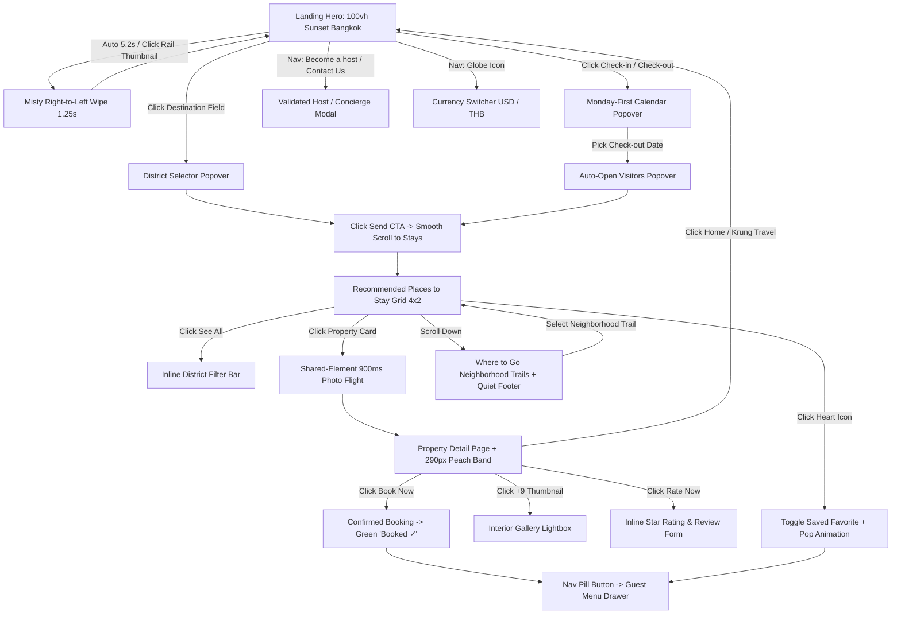

# Krung Travel — UI/UX Flowchart & Figma Architecture Spec

## 1. Complete Application Page & State Flowchart

---

## 2. UI/UX Audit & Resolved Missing Items

| Area | Original Gap / Arrangement Risk | UI/UX Resolution Implemented |
|---|---|---|
| **Nav: Visitors Chevron** | Static label with chevron had no target menu | Wired quick-access popover (`Curated Stays`, `Saved Stays`, `My Bookings` counts) |
| **Nav: Globe & Menu Pill** | Unwired icons in top-right header | Globe toggles `USD $` / `THB ฿` live across all cards & booking totals; Pill opens slide-over Guest Menu Drawer (essential on mobile `<=1000px`) |
| **Nav: Where to Go & Host & Contact** | Links without destination views | `"Where to go"` links to curated Bangkok Pier Trails section; `"Become a host"` & `"Contact Us"` open validated modals matching `#fdf0e7` + Gilda Display |
| **Search Bar: Bangkok Field** | Static destination label | Interactive Bangkok District picker (`All Bangkok`, `Khlong San`, `Thonburi`, `Sathorn`, etc.) filtering stays live |
| **Detail Page: `+9` Thumbnail & `Rate Now`** | Static visual affordances | `+9` opens full photo gallery lightbox; `Rate Now` opens inline star + review submission updating review count |
| **Detail Page: Check-In / Check-Out** | Read-only box if user bypassed hero search | Defaults to `Dec 22 – Dec 27, 2026` with inline `"Change dates"` editor updating total nights & price |

---

## 3. Figma Planning & Design Token Matrix

### A. Frame & Grid Specs
- **Desktop Canvas**: `1440 × 900` (fluid `clamp(20px, 9.5vw, 170px)` horizontal gutter, zero side-bleed margin on Hero).
- **Tablet / Compact Breakpoint (`<= 1000px`)**: Nav hides center links & `"Become a host"`; card grids collapse `4 cols → 2 cols`; detail columns collapse `1.18fr / 1fr → 1fr`.
- **Mobile Breakpoint (`<= 640px`)**: Nav shows logo + globe + pill only; hero title wraps at `13–14vw` within `80vw`; caption & connector hidden on rail; search bar shifts to `2×2` grid + full-width Send button at `bottom: 16vh`.

### B. Color Tokens
- `bg/peach-hero`: `#f7d9c6` (`0% -> 115vh`)
- `bg/peach-mid`: `#fbe7da` (`175vh`)
- `bg/peach-end`: `#fdf0e7` (`100%`)
- `ink/primary`: `#1d1a1c`
- `ink/muted`: `#5c5156`
- `ink/subtle`: `#8a7f83`
- `accent/book`: `#f39419`
- `accent/star`: `#f7c325`
- `accent/heart`: `#ff4d5e`
- `status/confirmed`: `#249c60`

### C. Typography Tokens
- **Display Serif**: `Gilda Display` (`400`) — section headings (`clamp(26px, 2.45vw, 36px)`), property detail titles (`38px`).
- **UI & Hero Sans**: `Urbanist` (`300, 400, 500, 600, 700, 800`) — hero giant titles (`700`, `8.25vw` / `9.6vw` gradient-masked), nav logo (`300`, `26px`), card titles (`600`, `15.5px`).

### D. Motion Tokens
- `--ease`: `cubic-bezier(0.65, 0, 0.35, 1)` (900ms rail reflow, 900ms shared-element flight, 1250ms misty wipe)
- `--out`: `cubic-bezier(0.16, 1, 0.3, 1)` (1150ms word rise, 250ms cursor resize, 280ms popover drop-in)
